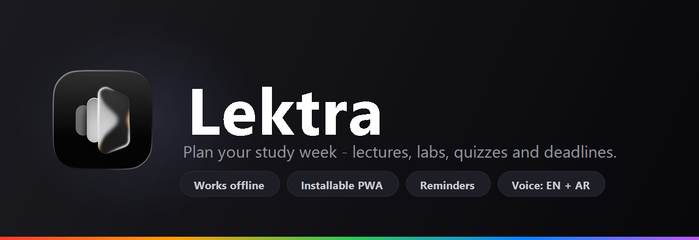

<div align="center">



**Plan your study week. Track lectures, labs, quizzes and deadlines. Works fully offline on your phone.**

[](#install-on-your-phone)
[](#why-it-works-offline)
[](#tech-stack)
[](#tech-stack)

### [▶ Open the app](https://ahmedkamalrezk.github.io/Lektra/)

</div>

---

## What is Lektra

Lektra is a phone-sized study planner for university students. You give it your weekly
timetable (lectures, sections, labs) plus one-off dates (quizzes, deadlines, midterms,
finals), attach lecture files to each subject, and it shows everything on a calendar.

The important part: **it is not a website you visit.** It installs onto your phone like a
real app, keeps its own icon on your home screen, opens full-screen with no browser bars,
and **works completely offline** — no account, no sign-in, no internet, no server storing
your data. Everything you enter lives on your own device.

It also understands **Egyptian Arabic and English**, both typed and spoken: say
"كويز الاحد الساعه 10 في مدرج 2" and the entry form fills itself in.

## Why it works offline

Most "offline" apps still phone home. Lektra genuinely does not, and that is by design:

| Layer | What it does |
|---|---|
| **Service worker** (`sw.js`) | On first visit it caches the entire app (18 files — HTML, CSS, all JS, icons, manifest). Every later launch is served from that cache, so the app opens instantly and works with **flight mode on**. |
| **IndexedDB** (`js/db.js`) | Your subjects, lectures and entries live here, plus the **actual bytes** of every lecture file you add. Survives reloads, closing the app, and rebooting the phone. |
| **localStorage** | A lightweight mirror of your data used for an instant first paint before IndexedDB loads. |
| **No backend, no account** | There is no server, no database, no analytics, and no Google Drive. Your timetable never leaves the device — with **one deliberate exception**: "Scan a timetable photo", which sends that one photo to Puter to be read, and only after you tap it. Nothing else is ever uploaded. |

The app also asks the browser for **persistent storage**, so Android/iOS won't quietly
delete your data when the device runs low on space.

---

## Everything it does

### Calendar
- **Month grid** with Sunday–Saturday columns, adjacent-month days dimmed, and today's
  date in a quiet high-contrast pill.
- **Each day shows its content inline** — up to 5 lines per cell: every entry starts with a
  small dot in the subject's colour, then a neutral subject name and a muted type/note line.
  Weekly classes render grouped by subject with `Lec` / `Sec` / `Lab` tags and the room.
  Subject colour stays in the dot, so the grid itself remains calm and near-monochrome.
- **Month navigation** two ways: the `‹` `›` arrow zones, or **swipe left/right** on the grid.
- **A single-line subject filter rail** under the grid — "All" plus one entry per subject,
  each with its colour dot and count. The selected filter is a quiet high-contrast pill;
  the rail scrolls sideways instead of stacking into rows of loud coloured labels.
- **Auto-jump**: add a quiz for next March and the calendar flips to that month for you.

### Entries
Seven entry types, split into two very different behaviours:

| Weekly (repeats every week) | Dated (happens once) |
|---|---|
| `Lecture`, `Section`, `Lab` | `Quiz`, `Deadline`, `Midterm`, `Final` |

- **Weekly entries** ask for a weekday, a time, and a **place** — these are your
  timetable rows and appear on *every* matching weekday.
- **Dated entries** ask for a date, an optional time, and a **note** (e.g. "Project",
  "Report", "Chapter 3") — these appear once.
- The add sheet **switches its own fields** depending on the type you pick: choosing
  `Quiz` hides the weekday picker and reveals the date field, and vice versa.
- **Tap any day** to open a day sheet listing everything on it — the weekday's classes
  and any dated entries — with a ✕ to delete each one and **+ Add entry** to add more.
- Deleting a subject cleans up after itself: its lectures, its dated entries **and** its
  stored files all go together.

### Subjects and lecture files
- **Subjects act as folders**, each auto-assigned a colour from the palette.
- **Add real lecture files** — PDFs, slides, images, anything — via a multi-select picker.
  They are stored on the device and shown with their size.
- **Tap a file to open or download it** any time, even offline.
- **Backup and restore** your schedule as JSON from Settings.

### Scan a timetable photo (AI import)
Typing out a whole college timetable is tedious, so Lektra can read one from a photo.

1. Tap **📷 Scan a timetable photo** on the Subjects screen (or in Settings).
2. Pick or take a photo of your timetable.
3. The image is shrunk to 1600 px, sent to a vision model, and asked for **strict JSON**.
4. You get a **review screen** — every detected class as an editable row with a checkbox
   (subject, type, day, time, place). Nothing is saved until you press **Save classes**.
5. Confirming creates any missing subjects, reuses subjects with the same name, and skips
   classes that already exist (same subject + type + day + time).

It is built for real timetables: **Arabic, English, or both**; Arabic-Indic digits
(`٩:٣٠`); `2 م` → `14:00`; weekday names in either language; and `سكشن` / `معمل` map to
section / lab. Unreadable fields come back blank for you to fill in, and anything the model
gets wrong is visible on the review screen rather than silently written into your week.

> **This is the only feature that needs internet**, and the only one that sends anything
> off your device. It uses [Puter.js](https://developer.puter.com), which needs **no API key
> and costs the developer nothing** — but it does ask you to sign in to a **free Puter
> account** the first time (a popup, once). The rest of Lektra stays 100 % offline.

### Voice and natural language
This is the most interesting part of the app. Tap the microphone and talk, or type a
sentence into the bar at the bottom and press Enter. Either way it parses the sentence and
**opens the entry form already filled in** — you just confirm and save.

It copes with normal, messy phrasing in **English and Egyptian Arabic**:

- **Days** — `sunday`…`saturday`, plus Arabic `الاحد`, and the colloquial spellings people
  actually use: `الاتنين`, `التلات`, `الاربع`.
- **Relative days** — `today` / `النهارده`, `tomorrow` / `بكره`, `day after tomorrow` / `بعد بكره`.
- **Dates** — month + day in either language (`15 may`, `20 ديسمبر`) and numeric
  `day/month` (`5/3`). A date that has already passed rolls forward to next year.
- **Times** — `الساعه 10`, `at 3`, `12:30`, `3.15`, plus Arabic fractions `ونص` (= :30) and
  `وربع` (= :15), and `مساء` / `بالليل` / `العصر` / `pm` / `صباحا` / `الصبح` / `am`.
- **A human rule**: a bare hour from 1–6 is assumed to be afternoon, because nobody
  schedules a lecture at 3 AM.
- **Places** — Arabic `قاعه`, `مدرج`, `معمل`, `لاب`, `مبني` and English `hall`, `room`,
  `lab`, `building`, then keeps the rest of the phrase as the room.
- **Entry type** — `كويز`/`quiz`, `تسليم`/`ديدلاين`/`deadline`/`due`/`واجب`,
  `ميدترم`, `فاينل`, `سكشن`, `محاضره`.
- **Notes** — `مشروع`/`project` → "Project", `تقرير` → "Report", and so on.
- **Arabic-Indic digits** (`٠١٢٣٤٥٦٧٨٩`) are converted to `0-9`, and hamza/alef spellings
  are normalised (`أ إ آ → ا`, `ة → ه`, `ى → ي`) so your spelling doesn't have to be perfect.
- **Smart weekday logic**: saying "Saturday" *on* a Saturday means the coming Saturday,
  not today.
- The sheet **echoes what it heard** at the top with a 🎙/✎ icon, so you can spot a
  mis-hearing before you save.
- **Helpful voice errors** instead of silent failure — it tells you specifically if the
  microphone is blocked, if there's no microphone, if it needs internet, or if it heard
  nothing.

#### Examples (all verified against the real parser)

| You say / type | What Lektra creates |
|---|---|
| `data structures section monday 12:30 in room 5` | Section · Monday · 12:30 · Room 5 |
| `quiz friday 10:30` | Quiz · the coming Friday · 10:30 |
| `project deadline thursday` | Deadline · Thursday · note "Project" |
| `data structures final 15 may` | Final · 15 May |
| `final 5/3` | Final · 5 March |
| `midterm 20 ديسمبر` | Midterm · 20 December |
| `كويز الاحد الساعه 10 في مدرج 2` | Quiz · Sunday · 10:00 · مدرج 2 |
| `سكشن الاتنين الساعه 12 في قاعه 5` | Section · Monday · 12:00 · قاعه 5 |
| `تسليم مشروع الخميس` | Deadline · Thursday · note "Project" |
| `محاضره بكره الصبح في مدرج 4` | Lecture · tomorrow · مدرج 4 |

### Search
- Tap the magnifier for a search sheet that matches **subjects, places, entry types and
  dates** in one query.
- Results are tappable: tapping a lecture **jumps the calendar to that weekday and opens
  the day**; tapping a subject **opens its folder**.
- A **Go to today** button returns you to the current month.

### Reminders
Lektra nudges you before classes and deadlines.

- **Per-type lead times** in Settings, each with a minutes / hours / days picker:
  - **Classes** (lecture / section / lab) — default **10 minutes** before
  - **Quizzes** — default **1 day** before
  - **Deadlines** — default **3 days** before, *plus* a second reminder **1 day** before
  - **Midterms & finals** — default **1 day** before, *plus* a second reminder **1 hour** before
- **Enable from Settings** — it asks for notification permission and shows you exactly
  where you stand (allowed / blocked / unsupported by this browser).
- **A Test button**, so you can see what a reminder looks like before you rely on one.
- **Fired once, never repeated.** Every reminder that goes out is remembered, so reopening
  the app doesn't spam you with the same alert.
- **Catch-up on reopen** — if reminders came due while you were away, opening Lektra tells
  you how many you missed and what they were.
- **Tapping a notification** brings the app to the front through the service worker.
- An entry with **no time** is treated as **09:00** when working out when to remind you.

> **The honest limit:** a web app cannot wake itself up. There is no OS alarm to set from a
> page, so these reminders fire **while Lektra is open or recently used**, plus the catch-up
> when you reopen it. If the app is fully closed, nothing fires at that exact moment — that
> is a browser restriction, not a bug, and the only real fix is a native app.

### Settings and data
- **Appearance** — Dark, Light, or System. Dark stays the default; Light is the same quiet
  layout on warm paper, and System follows the phone's appearance setting.
- **Voice language** — العربية (مصر) or English, which sets the speech recogniser locale.
- **Storage info** — how many files you have stored offline and roughly how much space
  they use, read live from the browser's Storage API.
- **Backup (export)** — downloads your whole schedule as a dated JSON file.
- **Restore (import)** — reads that file back in.
- **Clear all data** — wipes subjects, lectures, entries and files after a confirmation.

### Install and offline
- Installable on **Android** (Chrome: ⋮ → Install app) and **iPhone** (Safari: Share →
  Add to Home Screen).
- Runs in **standalone mode**: its own icon, no address bar, no browser chrome.
- Declared **portrait**, with a **maskable icon** so Android can shape it to the launcher.
- Respects **notch and home-indicator safe areas**, so nothing hides under the status bar.
- Works **fully offline** after the first load, including opening saved lecture files.

### Interface polish
- **Dark by default**, with Light and System options under Settings → Appearance.
- On a desktop it renders inside a **phone frame** (rounded corners, bezel) once the window
  is wider than 560px, so it looks like the device it's meant for.
- **Container queries** keep every element scaling with the app's own width rather than the
  window, so the layout is identical on any screen.
- **Bottom-sheet modals** that dismiss when you tap the backdrop.
- **Toast messages** for confirmations and errors.
- Icon buttons carry **`aria-label`s** for screen readers.

---

## Tech stack

Deliberately boring, deliberately dependency-free. There is **no framework, no bundler,
no `npm install`, and no build step** — the files you see are the files that run.

**Languages & markup**
- **HTML5** — a single 46-line shell (`index.html`); all screens are rendered into it
- **CSS3** — custom properties, **CSS Grid**, flexbox, `@keyframes`, `aspect-ratio`,
  media queries and `prefers-color-scheme`
- **Vanilla JavaScript** — ES5-style, written as plain global scripts loaded in order

**Modern CSS techniques used**
- **Container queries** (`container-type: inline-size` + `cqw` units) for device-relative sizing
- `env(safe-area-inset-*)` for notched displays
- `100dvh` with a `@supports` fallback for mobile browser toolbars
- `color-scheme` switches between dark and light so native date/time pickers match the theme

**Web platform APIs used**
| API | Used for |
|---|---|
| **Web App Manifest** | Installability, name, icons, standalone display |
| **Service Worker** + **Cache Storage** | Offline app shell |
| **IndexedDB** | App data and lecture file bytes |
| **localStorage** | Instant-start mirror of app data |
| **Storage API** (`estimate`, `persist`) | Storage usage display and eviction protection |
| **Notifications API** + `ServiceWorkerRegistration.showNotification` | Class and deadline reminders |
| **Web Speech API** (`SpeechRecognition`) | Voice input |
| **Canvas** (`drawImage`, `toBlob`) | Shrinking a timetable photo before upload |
| **Puter.js** (CDN, loaded on demand) | Vision model for the optional AI timetable import |
| **File API**, **Blob**, **`URL.createObjectURL`** | Picking, storing and reopening lecture files |
| **Fetch**, **Promises** | Async data flow |
| `Blob` + anchor download | JSON backup export |

**Hosting & tooling**
- **GitHub Pages** — free HTTPS hosting (HTTPS is a hard requirement for installing a PWA)
- **Git** for version control, **GitHub CLI** for publishing
- **Python `http.server`** (`serve.ps1` → `dev-server.py`) for local development on `localhost`, with `Cache-Control: no-store` so edits show up on reload
- Icons and the README banner were generated programmatically with **.NET `System.Drawing`**

**Requirements:** Chrome/Edge 105+, Safari 16+, or Firefox 110+ (container queries and
service workers are the strictest requirements). No install, no runtime dependencies.

---

## How it works

### Data model

```js
subject = { id, name, files: [ { id, name, size, type } ] }

lecture = { id, subjectId, kind, weekday, time, place }   // weekly: lecture / section / lab
event   = { id, subjectId, kind, date, time, note }       // dated:  quiz / deadline / midterm / final
```

A **`lecture`** carries a `weekday`, so it renders on every matching weekday of every month.
An **`event`** carries a concrete `date`, so it renders exactly once. Both reference a
subject by `subjectId`, which is how colour and filtering work. `kind` is the single field
that decides which of the two shapes an entry takes.

### Rendering

Rendering is intentionally simple: `render()` reads the global `state` and rebuilds the
current screen's HTML from scratch, then re-attaches event handlers. There is no virtual
DOM and no diffing, which is entirely fine at this scale and keeps the code easy to follow.

### Storage layers

```
   user action
        │
        ▼
   state (in memory)  ──►  render()  ──►  screen
        │
        ├──►  localStorage  ("campus")      instant first paint on next launch
        └──►  IndexedDB     ("lektra")      the authoritative copy
                 ├── "kv"    → the whole state object
                 └── "files" → { id, subjectId, name, type, size, blob }
```

On launch the app paints immediately from the `localStorage` mirror, then loads the
authoritative copy from IndexedDB and re-renders if it differs. Lecture files are addressed
by `id`: the metadata sits in `subject.files` inside the state object, while the actual
Blob lives in the `files` store — so the state stays small and files never bloat it.

---

## Project structure

```
Lektra/
├── index.html          App shell: buttons, main area, input bar, modal, toast
├── manifest.json       PWA metadata: name, icons, standalone, theme colour
├── sw.js               Service worker: caches the app shell for offline use
├── serve.ps1           Local dev server helper (http://localhost)
├── dev-server.py       Static server with Cache-Control: no-store (no stale edits)
├── README.md
├── css/
│   └── style.css       All styling: light/dark themes, grid, container queries
├── js/
│   ├── db.js           IndexedDB: state store, file store, backup/restore
│   ├── state.js        App state, helpers, entry types, persistence
│   ├── modal.js        Bottom-sheet modal
│   ├── calendar.js     Month grid, day sheet, add-entry form
│   ├── subjects.js     Subject folders and local file storage
│   ├── search.js       Search across subjects, lectures and events
│   ├── voice.js        Arabic + English natural-language parsing
│   ├── reminders.js    Class/deadline reminders, lead times, catch-up
│   ├── scan.js         Optional AI import: photo → parsed timetable → review
│   └── main.js         Buttons, settings, service worker registration, boot
└── assets/
    ├── icon.png               192×192 source icon
    ├── icon-192.png           PWA icon
    ├── icon-512.png           PWA icon (install requirement)
    ├── icon-maskable-512.png  Adaptive icon for Android launchers
    ├── apple-touch-icon.png   iOS home-screen icon
    └── banner.png             This README's banner
```

---

## Run it locally

```powershell
powershell -ExecutionPolicy Bypass -File .\serve.ps1
```

Then open <http://localhost:8080>.

`localhost` counts as a secure context, so the service worker and the install button both
work locally. **Don't open `index.html` directly as a file** — service workers are disabled
on `file://`, so you'd lose offline mode, installability and the database.

The dev server sends `Cache-Control: no-store` (that's why it's `dev-server.py` and not a
plain `python -m http.server`). Without it, Chrome heuristically caches your JS and you end
up debugging a file that the browser isn't actually loading.

## Deploy

This repo is already deployed with **GitHub Pages**:

1. Push to `main`.
2. Repository **Settings → Pages → Source: Deploy from a branch → `main` / `/ (root)`**.
3. The site publishes to `https://<user>.github.io/<repo>/` and rebuilds on every push.

Because everything uses **relative paths** (`./`, `js/db.js`, `assets/...`), it works
unchanged under that sub-path. Free GitHub Pages requires a **public** repo; if you'd rather
keep the code private, Netlify and Cloudflare Pages both host private repos for free.

> **When you ship a change**, bump the `CACHE` string in `sw.js` (e.g. `lektra-v3` →
> `lektra-v4`). The service worker is cache-first on purpose, so without a version bump
> phones will keep serving the old build.
>
> The install step fetches every asset with `cache: "reload"` on purpose. A plain
> `cache.addAll()` can be satisfied by the browser's **HTTP cache**, which would bake a
> stale file into the *new* cache version — and then serve it forever.

## Install on your phone

**Android (Chrome)**
1. Open the app's HTTPS link.
2. Tap **⋮** → **Install app**.
3. Confirm. It lands on your home screen and opens full-screen.

**iPhone (Safari)**
1. Open the app's HTTPS link **in Safari**.
2. Tap **Share** → **Add to Home Screen**.

Installing requires **HTTPS** — that is a browser rule, not a Lektra limitation, which is why
the app is hosted rather than opened from a file.

## Browser support

| Browser | Status |
|---|---|
| Chrome / Edge (Android + desktop) | Full support, including voice input |
| Safari / iOS WebKit 16+ | Full support; voice input depends on the OS recognising speech |
| Firefox 110+ | Full support; voice input not available (no `SpeechRecognition`) |

Where speech recognition is unavailable the app says so and you can simply **type** the
sentence instead — the parsing is identical.

## Known limitations

Honest list, verified by testing the parser directly:

- **The AI import needs internet and a free Puter account.** It is the only part of Lektra
  that goes online, and the only part that sends anything off the device (just the one
  photo, only when you tap it). It also needs the browser to allow the Puter sign-in popup.
- **The AI can misread a timetable.** That's why nothing is saved automatically — every
  detected class is shown as an editable row on a review screen first. Blurry, angled, or
  badly cropped photos produce worse results. It reads **weekly class tables**, not
  exam-schedule tables with dates.
- **Times need a marker.** `quiz friday 10:30` works, and so does `at 9` / `الساعه 9`, but a
  bare `9am` with no `at` is not recognised as a time. Write `at 9am` or `9:00`.
- **`lab tuesday 3 ونص` misfiles the place.** Because the sentence starts with the word
  "lab", the place extractor captures the whole remainder as the room. Write
  `tuesday at 3 ونص` instead, or fill the form by hand.
- **Arabic word-fractions need a detected hour first** (`ونص`, `وربع` only apply once an
  hour has been parsed).
- **The UI text is English only.** The language setting changes *speech recognition*
  (`ar-EG` / `en-US`), not the on-screen strings — so the interface is English even when
  you speak Arabic.
- **`x/y` dates are read as day/month** (Egyptian convention), so `5/3` means 5 March.
- **There is no edit.** Entries can be created and deleted, but not changed — delete and
  re-add.
- **Lecture files are per-device.** They are not part of the JSON backup and don't sync
  between devices.
- **Reminders can't fire while the app is fully closed.** A web app has no way to schedule
  OS-level alarms, so reminders arrive while Lektra is open or recently used, plus a
  catch-up summary when you reopen it. Genuine closed-app notifications would require
  wrapping Lektra as a native Android app (Capacitor + `@capacitor/local-notifications`),
  which would keep it offline and server-free.
- **Browser storage can be cleared** by the user wiping site data. Lektra asks for
  persistent storage to make that less likely; the JSON backup is your real safety net.

## License

No license file is included yet, which means all rights are reserved by default. If you want
to let others use or contribute to Lektra, add an MIT license — happy to do that on request.
