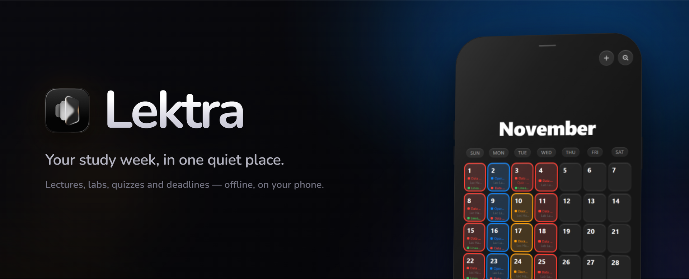
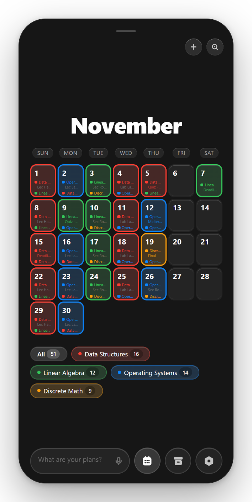
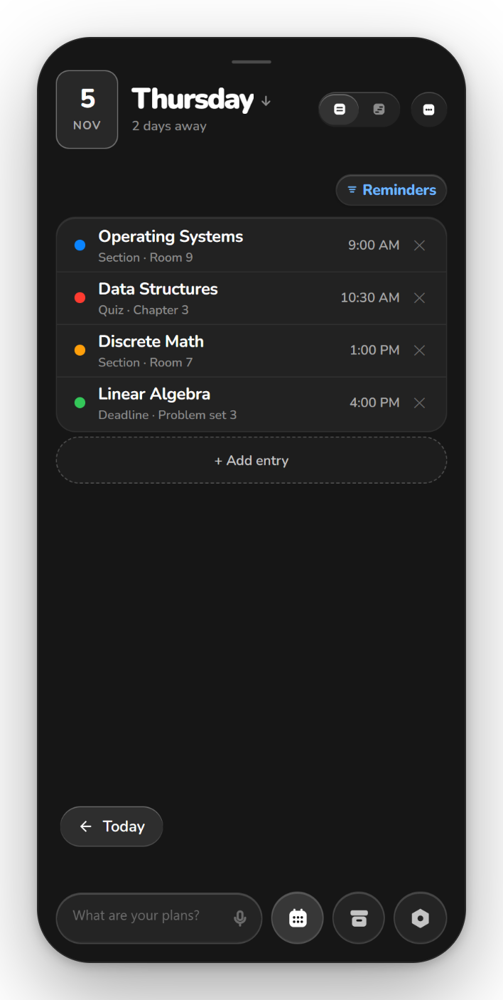
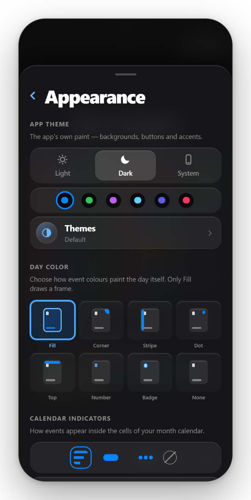

<div align="center">



<br>

### [Open Lektra →](https://ahmedkamalrezk.github.io/Lektra/)

<sub>iPhone &nbsp;·&nbsp; Android &nbsp;·&nbsp; Desktop &nbsp;·&nbsp; Installs like an app &nbsp;·&nbsp; v188</sub>

</div>

---

## Design that gets out of the way.

Lektra is built around one idea: your timetable should be easier to read than the paper
it replaced.

No dashboard. No feed. No account. Just the month in front of you, your subjects in the
margins, and everything that matters a tap away.

> A planner should feel like a place, not a product.

<br>

<div align="center">


&nbsp;&nbsp;

&nbsp;&nbsp;


<sub><b>Month</b> &nbsp;·&nbsp; <b>Day</b> &nbsp;·&nbsp; <b>Appearance</b></sub>

</div>

---

## Everything in its place.

- **The month, at a glance.** Every day carries its classes and dated entries, coloured by
  subject. Swipe between months, filter down to one subject, and let the calendar jump to
  the month you just added something to.
- **Seven entry types, two behaviours.** Lectures, sections and labs repeat weekly. Quizzes,
  deadlines, midterms and finals happen once. The form reshapes itself around the type you
  choose.
- **A day view with manners.** Tap a day for its full agenda. Long-press any entry to
  select, edit, move, prioritise, duplicate or delete it — with a warning before anything
  is lost.
- **Subjects that keep their files.** Each subject is a colour-coded folder. Lecture PDFs,
  slides and images are stored on the device and stay downloadable offline.
- **A photo is enough.** Point Lektra at a timetable in Arabic or English. Every detected
  class arrives on a review screen first, ready to edit, and nothing is saved until you say
  so. Scan the same photo again and the answer is already there.
- **Speak it, or type it.** “Quiz Sunday at 10 in Hall 2” or “كويز الاحد الساعه 10 في مدرج 2”
  fills the form for you.
- **Reminders that wait for you.** Lead times by entry type, each reminder fired once, with
  a quiet catch-up when you return.
- **A theme for the mood.** Light, dark or system, the grayscale Quiet theme, 44 presets,
  14 palettes, and complete control over how the month is painted.

---

## Quiet by design.

### Offline, genuinely.
The app shell and your data live on the device. Flight mode changes nothing.

### Private by default.
No account, no analytics, no server, no tracking. The only thing ever uploaded is the
timetable photo you choose to scan.

### Nothing to install.
Plain HTML, CSS and JavaScript. No framework, no bundler, no build step, no dependencies.
The files you see are the files that run.

---

## On your home screen.

- **iPhone** — open the link in Safari, tap **Share**, then **Add to Home Screen**.
- **Android** — open the link in Chrome, tap the menu, then **Install app**.
- **Desktop** — open the link. On a wide window it appears inside a phone frame.

Lektra offers to install itself the first time you open it, with a one-tap prompt
where the browser supports it and short steps where it does not.

Installing needs HTTPS — a browser rule, not a Lektra one.

---

<details>
<summary><b>Voice, in either language</b></summary>

<br>

Tap the microphone and speak, or type a sentence into the bar and press Enter. Lektra
parses it, echoes what it heard, and opens the entry form already filled in.

| You say or type | Lektra creates |
|:--|:--|
| `data structures section monday 12:30 in room 5` | Section · Monday · 12:30 · Room 5 |
| `quiz friday 10:30` | Quiz · the coming Friday · 10:30 |
| `project deadline thursday` | Deadline · Thursday · note “Project” |
| `data structures final 15 may` | Final · 15 May |
| `midterm 20 ديسمبر` | Midterm · 20 December |
| `كويز الاحد الساعه 10 في مدرج 2` | Quiz · Sunday · 10:00 · مدرج 2 |
| `سكشن الاتنين الساعه 12 في قاعه 5` | Section · Monday · 12:00 · قاعه 5 |
| `تسليم مشروع الخميس` | Deadline · Thursday · note “Project” |

It understands relative days (`today`, `tomorrow`, `بكره`), Arabic-Indic digits, `2 م` →
14:00, `ونص` and `وربع` for :30 and :15, weekday names in either language, and the messy
spellings people actually use. A bare hour from 1–6 is assumed to be afternoon, because
nobody schedules a lecture at 3 AM.

</details>

<details>
<summary><b>How it is built</b></summary>

<br>

**A single shell. No build step.** `index.html` loads plain global scripts in order, and
every screen renders into one main area. There is no framework, no virtual DOM, no bundler,
and no `npm install`.

| Layer | Role |
|:--|:--|
| **Service worker** | Caches the complete app shell on first visit, so every later launch is served locally. |
| **IndexedDB** | The authoritative copy of your data, the bytes of every lecture file, and the result of every scanned timetable. |
| **localStorage** | A small mirror used for an instant first paint before IndexedDB opens. |

**Data**

```js
subject = { id, name, files: [ { id, name, size, type } ] }
lecture = { id, subjectId, kind, weekday, time, place }   // repeats weekly
event   = { id, subjectId, kind, date, time, note }       // happens once
```

A **lecture** carries a weekday and appears on every matching day; an **event** carries a
concrete date and appears exactly once. Both reference a subject by `subjectId`, which is
how colour, filtering and reminders find their way home.

**Files**

```
Lektra/
├── index.html          app shell
├── manifest.json       install metadata
├── sw.js               offline cache
├── serve.ps1           local server
├── css/style.css       all styling and theme tokens
├── js/                 db · state · appearance · month · modal · calendar
│                       daymenu · subjects · search · voice · chat · reminders
│                       scan · scan-worker · camera · main
└── assets/             icons, hero, screenshots, bundled font
```

</details>

<details>
<summary><b>Run it locally</b></summary>

<br>

```powershell
powershell -ExecutionPolicy Bypass -File .\serve.ps1
```

Then open <http://localhost:8080>.

`localhost` counts as a secure context, so the service worker and install button both work.
Do not open `index.html` directly as a file — service workers are disabled on `file://`, so
you would lose offline mode, installability and the database.

The dev server sends `Cache-Control: no-store`, so edits show up on reload instead of
Chrome serving a stale script from its heuristic cache.

</details>

<details>
<summary><b>Deploy</b></summary>

<br>

The app is hosted on **GitHub Pages** from `main`.

1. Push to `main`.
2. Repository **Settings → Pages → Source: Deploy from a branch → `main` / `/(root)`**.
3. The site publishes to `https://<user>.github.io/<repo>/` and rebuilds on every push.

All paths are relative, so the app works unchanged under that sub-path. Free GitHub Pages
requires a public repository; Netlify and Cloudflare Pages host private ones.

When you ship a change, bump `CACHE` in `sw.js` **and** `APP_BUILD` in `js/main.js`
together. The service worker is cache-first on purpose, so without a version bump phones
keep serving the old build. Settings → More shows the build the phone is actually running.

</details>

<details>
<summary><b>Browser support</b></summary>

<br>

| Browser | Status |
|:--|:--|
| Chrome / Edge (Android + desktop) | Full support, including voice input |
| Safari / iOS WebKit 16+ | Full support; voice input depends on the OS recognising speech |
| Firefox 110+ | Full support; voice input unavailable (no `SpeechRecognition`) |

Where speech recognition is unavailable, Lektra says so and you can type the sentence
instead — the parsing is identical.

</details>

<details>
<summary><b>The honest details</b></summary>

<br>

- **The AI import needs internet and a free Puter account.** It is the only part of Lektra
  that goes online, and the only part that sends anything off the device — just the one
  photo, only when you tap it. It also needs the browser to allow the sign-in popup.
- **The AI can misread a timetable.** Nothing is saved automatically; every detected class
  is shown as an editable row on a review screen first. Blurry, angled or badly cropped
  photos produce worse results. It reads weekly class tables, not exam schedules with dates.
- **Times need a marker.** `quiz friday 10:30` works, and so does `at 9` or `الساعه 9`, but a
  bare `9am` with no `at` is not recognised. Write `at 9am` or `9:00`.
- **`lab tuesday 3 ونص` misfiles the place**, because the sentence starts with the word
  “lab”. Write `tuesday at 3 ونص` instead, or fill the form by hand.
- **Arabic word-fractions need an hour first** (`ونص` and `وربع` only apply once an hour has
  been parsed).
- **The interface is in English.** The language setting changes speech recognition
  (`ar-EG` / `en-US`), not the on-screen strings.
- **`x/y` dates are read as day/month** (Egyptian convention), so `5/3` means 5 March.
- **Lecture files are per-device.** They are not part of the JSON backup and do not sync
  between devices.
- **Reminders cannot fire while the app is fully closed.** A web app cannot schedule an OS
  alarm. Reminders arrive while Lektra is open or recently used, plus a catch-up summary
  when you return. True closed-app notifications would need a native wrapper.
- **Browser storage can be cleared** by wiping site data. Lektra asks for persistent
  storage to make that less likely; the JSON backup is the real safety net.

</details>

---

<div align="center">

<sub><b>Lektra</b> &nbsp;·&nbsp; v188 &nbsp;·&nbsp; built to be kept, not bookmarked</sub>

<br>

<sub>Designed for students who would rather study than plan.</sub>

<br><br>

<sub>No license file is included yet, which means all rights are reserved by default.<br>
An MIT license can be added on request.</sub>

</div>
